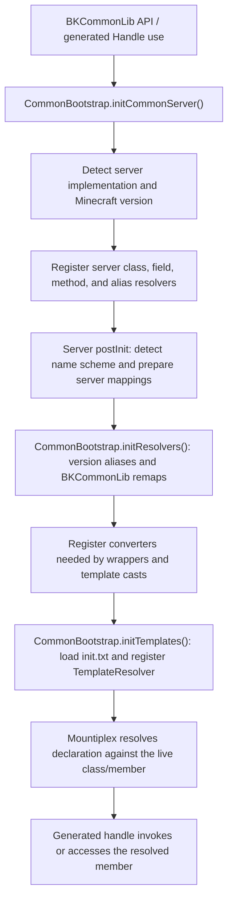

# Templates and Runtime Resolution

**Audience:** BKCommonLib maintainers working on version-dependent server access, generated handles, or bootstrap failures. Plugin authors should normally use the stable wrappers and utilities in BKCommonLib rather than these internals.

This page explains how a BKCommonLib template declaration gets from source to a runtime class or member, and how server detection, class/member remapping, converters, and the test server fit into that path. It focuses on BKCommonLib-specific setup; it does not restate Mountiplex's template language or handle-generation rules.

For the template syntax itself, read Mountiplex's [Template Syntax reference](https://github.com/bergerhealer/Mountiplex/blob/master/docs/template-syntax.md). Mountiplex's [Overview](https://github.com/bergerhealer/Mountiplex/blob/master/docs/overview.md), [Resolver reference](https://github.com/bergerhealer/Mountiplex/blob/master/docs/resolver.md), and [Conversion guide](https://github.com/bergerhealer/Mountiplex/blob/master/docs/conversion.md) explain the underlying mechanisms.

## Source layout and generated handles

- Template source files are `.txt` files under [`src/main/templates/com/bergerkiller/templates/`](../../src/main/templates/com/bergerkiller/templates/). The entry point is [`init.txt`](../../src/main/templates/com/bergerkiller/templates/init.txt), which includes global macros, common remappings, Bukkit/CraftBukkit declarations, and Minecraft declarations. Keep new template files reachable from this include tree.
- A template's declared Java package and class name identify the runtime type it describes. The generated handle for that declaration is placed in the corresponding package under `com.bergerkiller.generated` and uses the `Handle` suffix. For example, a declaration for `net.minecraft.server.level.ServerPlayer` has the handle `com.bergerkiller.generated.net.minecraft.server.level.ServerPlayerHandle`.
- [`build.gradle.kts`](../../build.gradle.kts) configures the Mountiplex Gradle plugin to read `com/bergerkiller/templates/init.txt`, generate handles with the `com/bergerkiller/generated` target prefix, and rewrite annotation strings. Generated handles are checked in under [`src/main/generated/com/bergerkiller/generated/`](../../src/main/generated/com/bergerkiller/generated/); regenerate them from their source declarations rather than editing them by hand.
- BKCommonLib's public wrappers and internal code use generated handles such as [`ServerPlayerHandle`](../../src/main/generated/com/bergerkiller/generated/net/minecraft/server/level/ServerPlayerHandle.java) to access the actual runtime type through Mountiplex.

The template engine and generated handles are separate from class-name resolution. A handle can consistently expose `ServerPlayer`, while the runtime resolver maps that name to whichever class the current server actually contains.

## From a call site to a runtime member

The following is the normal dependency order. `initCommonServer()` is lazy; template loading is separately lazy and must happen only after the server resolver and converters are ready.

In more detail:

1. `CommonBootstrap.initCommonServer()` creates a `TemplateResolver`, installs known package names, then chooses a `CommonServer` implementation. It tries specialized server types before generic Spigot/CraftBukkit fallbacks; see the server candidate list in [`CommonBootstrap`](../../src/main/java/com/bergerkiller/bukkit/common/internal/CommonBootstrap.java).
2. `initServerResolvers(server)` registers any resolver interfaces implemented by that server with Mountiplex's global `Resolver`. These include class-path, field-name, method-name, compiled-member, and alias resolvers. The server resolver is registered before `server.postInit()`, so mapping setup can use it.
3. `server.postInit(event)` discovers the Minecraft version and initializes mapping data for that server family. `CraftBukkitServer` detects whether classes are Mojang-mapped or Spigot-mapped and configures the relevant class/member mappings. Hybrid implementations may add their own remapper integration.
4. After the server is accepted, `CommonBootstrap.initResolvers(server)` installs BKCommonLib's cross-version class substitutions and compatibility remaps. On CraftBukkit-derived servers, the class substitutions are passed to `CraftBukkitServer.setEarlyRemappings()` so they are applied before Mojang-to-Spigot translation and package relocation. Other server types get an additional class resolver.
5. The same bootstrap stage registers `WrapperConversion`, `HandleConversion`, `NBTConversion`, and other common or version-gated converters. Converter registration must precede template initialization when declarations use converted types.
6. `CommonBootstrap.initTemplates()` loads the template bundle and registers its `TemplateResolver` as a class-declaration resolver. Mountiplex then resolves names and declarations through the registered resolver chain and builds callable accessors for the generated handle.

Do not initialize a template from converter registration or while the server's resolver tables are still being built. A template may itself require a converter or another template, so changing this order can create unresolved types or initialization cycles.

## Preloading and diagnosing initialization deadlocks

`CommonPlugin` provides the `preloadTemplateClasses` configuration option, disabled by default. When enabled, startup loads and initializes all generated template classes in parallel across the available CPU cores, then forces their template declarations to initialize. This can surface server incompatibilities earlier and avoid lag from lazy initialization later, at the cost of loading classes that may never be used and consuming more memory. It is intended primarily for debugging.

Parallel template initialization can expose deadlocks caused by unsafe initialization dependencies. `CommonBootstrap.preloadTemplateClasses(Random)` includes a diagnostic mode: passing a non-null `Random` shuffles the classes before the parallel load. Repeating this with different seeds can exercise different initialization orders and help reproduce or identify deadlocks caused by code that initializes templates in the wrong order. The normal `CommonPlugin` option passes `null`, so it does not shuffle the order.

## Class paths, fields, and methods

Resolution is layered, not a single Mojang-to-runtime rename. For a class name, the server resolver first applies BKCommonLib's version-specific substitutions, then translates Mojang class names to the server's class names when required, then performs CraftBukkit package relocation or old NMS package-version relocation. A hybrid server can add its own final mapping. Field and method lookups use the resolved declaring `Class<?>`, then pass the Mojang-facing member name through the active field or method resolver. Method resolution also uses the requested parameter types to disambiguate overloads.

The global Mountiplex `Resolver` is the point where registered translators are applied. Resolver registration and chaining are Mountiplex behavior; see its [Resolver reference](https://github.com/bergerhealer/Mountiplex/blob/master/docs/resolver.md). BKCommonLib-specific resolver setup is in `CommonBootstrap`, `CraftBukkitServer`, and the selected server implementation.

### Mojang and Spigot name eras

The name scheme must be detected rather than inferred from the Minecraft version alone. Before official Mojang-mapped server jars became standard, server jars used Spigot/NMS class names and obfuscated members. In the intermediate era, Mojang class names were useful as BKCommonLib's stable declaration names, but the live jar still used Spigot class names and obfuscated fields and/or methods. Current server jars use the official Mojang names directly.

`CraftBukkitServer.postInit()` establishes the mode:

- On current Mojang-mapped versions, the Mojang class names are already the runtime names and the class, field, and method Mojang-to-obfuscated remappers are disabled.
- For versions where both Mojang-mapped and Spigot-mapped jars are possible, BKCommonLib probes the actual runtime classes and a known method to detect a Mojang-mapped jar. Do not treat the game version by itself as proof that the server jar uses one naming scheme.
- For intermediate versions that still use Spigot names, `HAS_MOJANG_FIELD_MAPPINGS` and `HAS_MOJANG_METHOD_MAPPINGS` gate member translation independently. Mojang's field mappings are used from the era where they are published; method mapping support starts later. `MojangRemapper` parses mappings and lazily builds per-declaring-class member tables.
- On older versions without downloadable Mojang server mappings, BKCommonLib cannot derive all old member names from Mojang's modern mapping files. Compatibility then depends on templates' version conditions and aliases, server-provided remappers, and explicit BKCommonLib compatibility logic.

For intermediate supported versions, `MojangMappings` obtains Mojang's server mapping file from the version manifest, caches it, and parses the ProGuard-style class/field/method entries. If it is missing, BKCommonLib attempts to download it. `MojangRemapper` translates those names to loaded Java classes through the class-path resolver, then maps fields and methods using their declaring class and method signature. Its reverse mapping supports aliases and diagnostic output.

Class-name translation has its own historical data source. [`class_mappings.dat`](../../src/main/resources/com/bergerkiller/bukkit/common/internal/resources/class_mappings.dat) is a bundled, versioned binary mapping from Mojang-facing class paths to Spigot class paths. `SpigotMappings.forVersion()` loads the closest available version from that resource. The mapping data is generated from Mojang class names and Spigot BuildData's Bukkit class mappings; nested classes can inherit the mapped outer-class path. This asset is especially important for old versions where the live names and package layout differ substantially and current Mojang member mappings are absent.

Before the modern unversioned `net.minecraft` package layout, class resolution also relocates names into the versioned `net.minecraft.server.<version>` root. CraftBukkit classes likewise move into the server's versioned `org.bukkit.craftbukkit.<version>` package. These package rewrites are done after logical substitutions so compatibility entries do not need to encode every package version.

## Server-specific remapping

`CommonBootstrap` selects a server adapter rather than assuming every Bukkit server has CraftBukkit's exact bytecode or mapping behavior. Each adapter can implement Mountiplex resolver interfaces and publish server variables used by templates. The selected adapter is responsible for making the stable declarations resolve against that server's runtime.

- [`MagmaServer`](../../src/main/java/com/bergerkiller/bukkit/common/server/MagmaServer.java) handles modern Magma, which exposes remapped NMS bytecode. It enables class-loader remapping and avoids loading some server class-file signatures that are rewritten at runtime.
- [`MagmaServerLegacy`](../../src/main/java/com/bergerkiller/bukkit/common/server/MagmaServerLegacy.java) and [`MohistServer`](../../src/main/java/com/bergerkiller/bukkit/common/server/MohistServer.java) integrate their runtime remapping utilities for class, field, and method names. Mohist also handles known class-path/member remapping bugs and multiple utility namespaces.
- [`ArclightServerLegacy`](../../src/main/java/com/bergerkiller/bukkit/common/server/ArclightServerLegacy.java) uses Arclight's remapper for older server versions. [`ArclightServer`](../../src/main/java/com/bergerkiller/bukkit/common/server/ArclightServer.java) detects modern Arclight, whose remapped class source behavior is enabled through Mountiplex's class-loader remapping.
- [`Bukkit4FabricServer`](../../src/main/java/com/bergerkiller/bukkit/common/server/Bukkit4FabricServer.java) asks its platform remapper for class, field, and method names.
- Other hybrid adapters (for example CatServer and legacy Arclight/Magma variants) contain similarly platform-specific detection or resolver overrides.

When diagnosing a class that resolves on Spigot but fails on a hybrid, inspect the selected adapter's `init()`, `postInit()`, `resolveClassPath()`, `resolveFieldName()`, `resolveMethodName()`, and `canLoadClassPath()` methods. `canLoadClassPath()` matters because class files may contain signatures that differ from classes as transformed and loaded by the platform; in that case Mountiplex must inspect the runtime class instead of trusting the original class-file metadata.

## Inline generated logic in `internal/logic`

Some compatibility work is too specialized or version-specific to express as ordinary handle members in a `.txt` template. Internal logic classes can declare a nested `Template.Class` whose methods are generated from inline source:

- The nested class uses `@Template.InstanceType` to identify the runtime class and often `@Template.Import`/`@Template.Optional` for its compilation context and availability.
- An abstract method marked `@Template.Generated("%NAME%")` refers to a matching `<NAME>` block in the adjacent source comment. The Mountiplex Gradle `remapAnnotationStrings()` task copies that block into the annotation string in compiled bytecode. This keeps multi-line generated method bodies maintainable while preserving compatibility with the project's Java source level.
- At runtime, `Template.Class.create(...)` resolves the declaration and generates the implementation. Calls through the abstract method enter that generated implementation; the surrounding Java class retains selection, lifecycle, and stable API logic.
- `@Template.Generated("...")` can also contain a short method declaration directly. The placeholder form is useful when the implementation is longer.

For example, [`PortalHandler_1_14.PortalTravelAgentHandle`](../../src/main/java/com/bergerkiller/bukkit/common/internal/logic/PortalHandler_1_14.java) wraps the version-specific portal forcer and supplies its operations through generated methods. Similar patterns appear in the entity, lighting, region, spawn, and item-variant handlers under `internal/logic`.

This `@Template.Generated` annotation use is not a `.txt` template file and is not the same as editing a generated `*Handle` source file. Do not move a long placeholder body to generated output; edit the annotated declaration and its named comment block.

## Bootstrap for tests

When a test first calls `CommonBootstrap.initServer()`, resolver and converter bootstrap runs first. If Bukkit has no server installed, `CommonBootstrap` invokes [`TestServerFactory`](../../src/main/java/com/bergerkiller/bukkit/common/server/test/TestServerFactory.java), which selects a version-specific factory for the server dependency under test and installs a minimally initialized Bukkit server.

The factory creates enough of the Minecraft runtime for tests that need registries and server-backed value APIs:

- Runs Minecraft bootstrap and initializes the registries needed by item, recipe, and related data APIs. On newer versions, the version-specific factories initialize registry layers, data-pack tags, and registry lookups required by those APIs.
- Creates minimally initialized server objects and assigns required fields such as the Bukkit server reference, main thread, logger, resource manager, data-fixer, and registry state as required by that version.
- Installs an empty world collection rather than loading worlds. It does not start the server lifecycle, tick a world, load chunks, or provide a live world for world-dependent behavior.

This is a registry-capable test fixture, not an embedded server. Item and registry APIs can be exercised, but world loading and operations that depend on a live world must use a server integration test or an appropriate mock. The version-specific initialization chain is in `TestServerFactory_1_8` through the current `TestServerFactory_*` subclasses.

## Debugging by symptom

| Symptom | Start with |
|---|---|
| A template class cannot be found | Server selection and version detection; then `CraftBukkitServer.resolveClassPath()` and the bundled class mappings. For hybrid servers, inspect that adapter's class resolver. |
| A field or method is missing | Confirm the declaring class was resolved as expected; then check whether the active server has Mojang member mappings, whether its resolver is registered, and whether the requested method signature matches. |
| A converted handle method cannot initialize | Verify converter registration happened before template initialization and that the converter does not initialize a dependent template during class initialization. |
| A `%NAME%` generated method is empty or incorrect | Check the `@Template.Generated` placeholder and matching comment label, then confirm the Mountiplex annotation-string rewrite task runs for main sources. |
| A test fails while accessing item or registry data | Check `CommonBootstrap.initServer()` and the version-specific `TestServerFactory` registry initialization. Do not assume the test fixture has worlds. |
